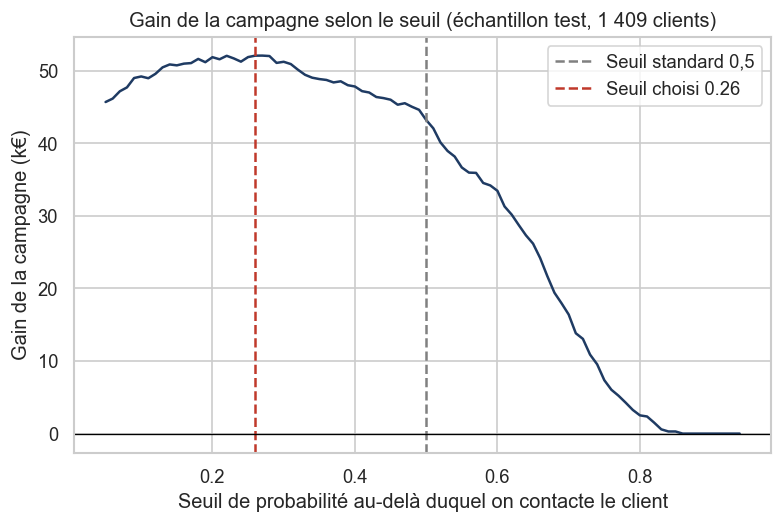

# Prédiction du churn client dans les télécoms (Python, machine learning)

Quels clients d'un opérateur télécom risquent de résilier leur abonnement, et lesquels faut-il contacter en priorité avec une offre de fidélisation ?

Ce projet compare 4 modèles de classification. Il vérifie si les écarts de performance sont statistiquement significatifs, puis choisit le seuil de décision selon le **gain d'une campagne de fidélisation**, et non avec le seuil standard de 0,5.

**Auteur :** David Diop, Master 2 Économétrie appliquée, IAE Nantes



## Résultats clés

- **26,5 %** des 7 043 clients ont résilié. Les classes sont déséquilibrées, donc les modèles sont évalués avec l'AUC, le rappel et la précision.
- La **régression logistique** (AUC test = 0,846) fait jeu égal avec la forêt aléatoire (0,845) et XGBoost (0,847). Un **test bootstrap** (2 000 tirages) montre que les écarts ne sont **pas significatifs**. Je retiens donc le modèle le plus simple à expliquer.
- Le seuil de décision est choisi sur des prédictions hors échantillon, puis appliqué au test. Le **seuil optimal de 0,26** fait passer le gain estimé de la campagne de **43 k€ à 52 k€** (+21 %) par rapport au seuil standard de 0,5. Le modèle détecte ainsi **8 partants sur 10**.
- Facteurs de départ, confirmés par les odds ratios et les valeurs SHAP : **contrat au mois**, **faible ancienneté**, **fibre optique** (odds ratio de 2,5), **paiement par chèque électronique**, absence d'options de sécurité ou d'assistance.

| Modèle | AUC (validation croisée, 5 plis) | AUC (test) |
| --- | --- | --- |
| Modèle naïf (référence) | 0,500 | – |
| Régression logistique | 0,846 ± 0,012 | 0,842 |
| Forêt aléatoire | 0,845 ± 0,011 | 0,843 |
| XGBoost | 0,847 ± 0,011 | 0,845 |

## Démarche

1. **Qualité des données** : vérification des doublons et des types de colonnes. J'ai trouvé 11 montants mal formés : ce sont des clients de 0 mois d'ancienneté, donc le montant vaut 0.
2. **Exploration** : churn selon le type de contrat, l'ancienneté et la facture mensuelle.
3. **Préparation** : séparation apprentissage/test stratifiée (80/20), puis un `Pipeline` scikit-learn (standardisation + encodage) pour éviter les fuites de données.
4. **Modélisation** : modèle naïf, régression logistique, forêt aléatoire, XGBoost, évalués par validation croisée.
5. **Évaluation sur le test** : AUC, rappel, précision, F1, courbes ROC.
6. **Significativité** : intervalle de confiance bootstrap de l'écart d'AUC.
7. **Seuil métier** : maximisation du gain d'une campagne de fidélisation. Hypothèses : une offre coûte 50 €, 30 % des partants contactés restent, et un client retenu vaut 12 mois de facture.
8. **Interprétation** : odds ratios avec `statsmodels` (variables colinéaires retirées), valeurs SHAP pour XGBoost.

## Lancer le projet

```bash
pip install -r requirements.txt
cd notebooks
jupyter notebook prediction_churn.ipynb
```

## Structure

```
prediction-churn-telecom/
├── data/Telco-Customer-Churn.csv     # données brutes
├── notebooks/prediction_churn.ipynb  # analyse complète, commentée
├── figures/                          # graphiques exportés
├── requirements.txt
└── README.md
```

## Limites et pistes

- Les données sont fictives et sans dimension temporelle : c'est une seule photo des clients à un instant donné.
- Les hypothèses de coût et de taux de succès de l'offre sont à valider avec le métier. Un test A/B mesurerait l'effet réel de l'offre.
- Pistes : optimiser les hyperparamètres des modèles d'arbres, et restituer les scores dans un tableau de bord (Power BI ou Shiny) pour les équipes commerciales.

## Données

Telco Customer Churn, IBM. Source : [IBM/telco-customer-churn-on-icp4d](https://github.com/IBM/telco-customer-churn-on-icp4d).

**Outils :** Python (pandas, scikit-learn, XGBoost, statsmodels, SHAP, matplotlib, seaborn), SQL (SQLite).

mail : diopdaouda904@gmail.com

